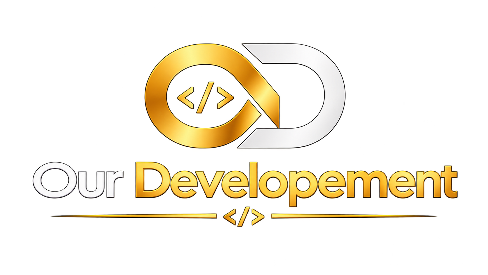
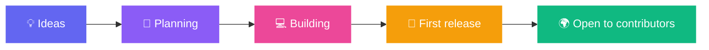

<!-- Animated waving header -->

  

  

  <!-- Animated typing tagline -->
  

   

  
  
  

  
  
  

  [**Who We Are**](#-who-we-are) •
  [**What We'll Build**](#-what-well-build) •
  [**Roadmap**](#-roadmap) •
  [**Get Involved**](#-get-involved) •
  [**Contact**](#-contact)

---

## 👋 Who We Are

Our-Development is a collective of engineers, designers, and problem-solvers who believe that great software emerges from **collaboration, clarity, and care**. We're building a home for tools, platforms, and products that help teams work better and ideas ship faster.

### Our principles

| | Principle | What it means |
|:-:|-----------|---------------|
| 🤝 | **Collaboration first** | Good ideas come from many voices. Reviews are conversations, not gatekeeping. |
| 🔍 | **Clarity over cleverness** | Readable code and honest documentation beat tricks every time. |
| 🧰 | **Care in the details** | Performance, accessibility, and developer experience are features, not afterthoughts. |
| 🌱 | **Share what we learn** | If it helped us, it can probably help someone else, so we write it down. |

---

## 🚀 What We'll Build

<table>
  <tr>
    <td width="50%" valign="top">
      <h3>🛠 Developer Experience</h3>
      CLI tools, libraries, and workflows that reduce friction and keep developers in flow.
    </td>
    <td width="50%" valign="top">
      <h3>🏗 Open Source Infrastructure</h3>
      Reliable, well-documented components the community can depend on.
    </td>
  </tr>
  <tr>
    <td width="50%" valign="top">
      <h3>📦 Product Engineering</h3>
      End-to-end applications crafted with attention to detail and performance.
    </td>
    <td width="50%" valign="top">
      <h3>📚 Knowledge Sharing</h3>
      Guides, templates, and resources that raise the bar for everyone.
    </td>
  </tr>
</table>

---

## 🗺 Roadmap

> [!NOTE]
> We haven't published any projects yet. This organization is brand new, and the first repositories are on the way. Follow us to be the first to see them.

| Stage | Status |
|-------|--------|
| 💡 Ideas & direction | ✅ In progress |
| 📝 Planning first projects | 🔜 Up next |
| 💻 Building in the open | ⏳ Coming soon |
| 🌍 Welcoming contributors | ⏳ Coming soon |

---

## 🤝 Get Involved

Even before our first repository lands, there are ways to be part of the journey:

- ⭐ **Follow the organization** to get notified when we publish
- 💬 **Share ideas** or suggestions through GitHub Discussions
- 📬 **Reach out** if you'd like to collaborate or contribute early
- 📸 **Follow along** on [Instagram](https://instagram.com/our_develop)

<b>❓ When will the first project be released?</b>

 

We're still in the planning stage. Follow the organization and you'll see new repositories as soon as they're published.

<b>❓ Can I contribute or collaborate right now?</b>

 

Yes. Email us at [hello@our-development.dev](mailto:hello@our-development.dev) with a bit about yourself and what you'd like to work on, and we'll get back to you.

<b>❓ How do I report a security issue?</b>

 

Please **don't** open a public issue. Email us at [hello@our-development.dev](mailto:hello@our-development.dev) with the details and we'll respond as quickly as we can.

---

## 📬 Contact

| Channel | Link |
|---------|------|
| 📧 **Email** | [hello@our-development.dev](mailto:abiajish2202@gmail.com) |
| 🐙 **GitHub** | [github.com/Our-Development](https://github.com/Our-Development) |
| 📸 **Instagram** | [@our_develop](https://instagram.com/our_develop) |

 

  Built with ☕ and curiosity by the <b>Our-Development</b> team.

<!-- Animated waving footer -->

  

